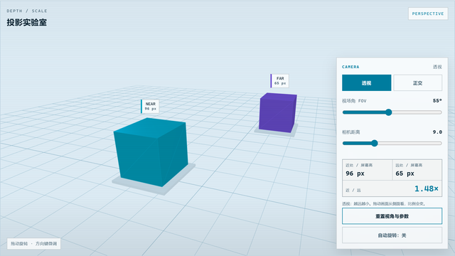
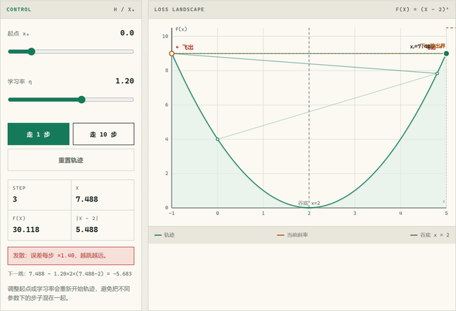
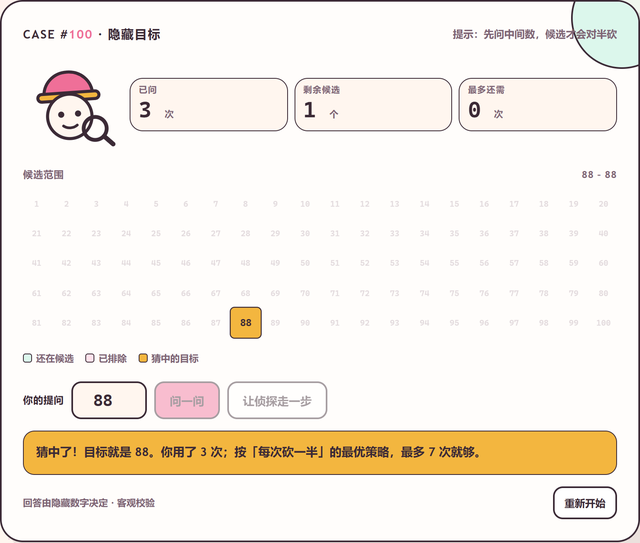
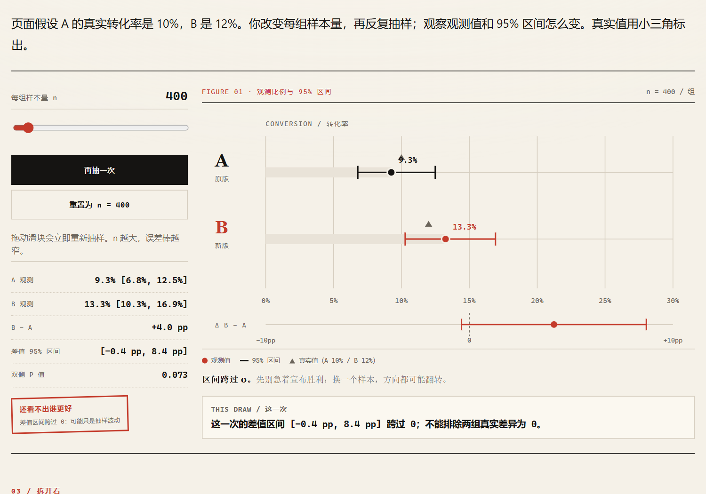
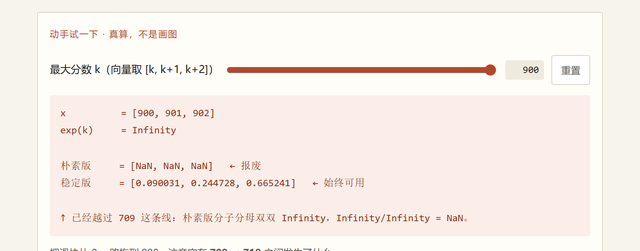
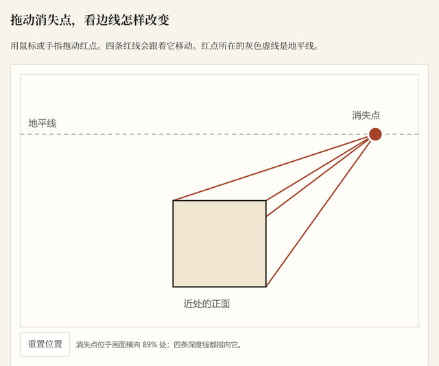
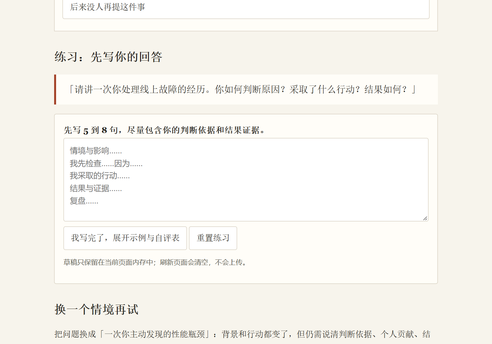
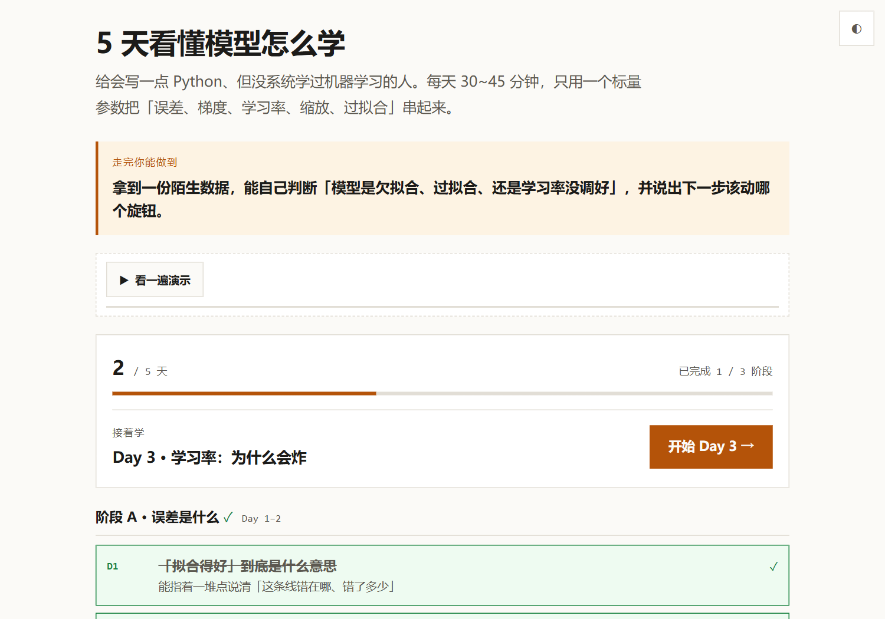

<p align="center">
  <a href="README.md">简体中文</a> · <a href="README.en.md"><b>English</b></a>
</p>

# knowvori · Interactive Learning Skill

<p align="center">
  
</p>

<p align="center">
  <a href="https://github.com/yoruniubi/knowvori/stargazers"></a>
  <a href="https://github.com/yoruniubi/knowvori/blob/main/LICENSE"></a>
  <a href="https://github.com/yoruniubi/knowvori/commits/main"></a>
</p>

<p align="center">
  <a href="#quick-start"></a>
  
  
  
</p>

> **Say what you want to learn. Get a hands-on lesson you can explore and check yourself on.**

A lesson is not an article, and not a pretty web page. It is a **small learning environment built around one concrete goal**: you operate something, you predict what happens, you see exactly where your calculation went wrong, and you apply the idea to a question you have never seen.

## Quick start

```bash
npx skills add yoruniubi/knowvori --skill knowvori
```

Then tell your agent:

> "I want to understand Attention. I know Python, but my linear algebra is shaky. Build me an interactive lesson that starts with hands-on exploration, then gives me an exercise."

The agent breaks down the goal, finds where you will get stuck, designs an interaction and an exercise, and delivers **one self-contained HTML file**. Double-click it. No server, no internet.

> "I want to get into data analysis in 21 days. Don't give me a reading list — split it into one lesson per day, plus a dashboard where I can see my progress."

This time you get a whole **route**: a `route.html` dashboard plus `day-01.html` through `day-21.html`. Each day is still a standalone single-file lesson, and progress is shared across files.

> Installing locally: run `npx skills add . --skill knowvori` from the repo root.

## Sample lessons

Seven single-file examples you can open right now, covering numerical computation, spatial reasoning, algorithms, statistics, and interview communication. At the end there is also a **complete 5-day route** (dashboard + 5 daily lessons). They share a teaching standard but **not a template**: engineering paper, hand-drawn sketch, magazine data feature, 3D space, oscilloscope lab, candy-colored game, editorial layout. Each speaks in its own voice. Light and dark themes follow the system.

> The four newest examples deliberately switch visual language: a real-time 3D camera experiment, a gradient descent console, a binary search game, and a data newspaper that resamples itself. The 3D example inlines Three.js (MIT) and is about 590KB — still one file, zero external requests, works offline.

> Images are uniform 10:7 previews. Click for full size; click the title to open the lesson.

### 3D · Space

[](docs/screenshots/three-camera-depth.png)

**[Why closer things look bigger](skills/knowvori/examples/three-camera-depth.html)**<br><sub>Three.js · perspective / orthographic · drag to orbit + field of view</sub>

### Live lab · Numerics

[](docs/screenshots/gradient-descent-lab.png)

**[Why a large learning rate blows up](skills/knowvori/examples/gradient-descent-lab.html)**<br><sub>Canvas · gradient descent · trajectory, learning rate, reset</sub>

### Gamified · Algorithms

[](docs/screenshots/binary-search-detective.png)

**[100 numbers, how few questions](skills/knowvori/examples/binary-search-detective.html)**<br><sub>DOM / CSS · binary search · candidate range and upper bound</sub>

### Data story · Statistics

[](docs/screenshots/ab-test-editorial.png)

**[Is 12% really better than 10%](skills/knowvori/examples/ab-test-editorial.html)**<br><sub>SVG · sampling / 95% intervals · resample to see the spread</sub>

### Engineering note · Numerics

[](docs/screenshots/softmax.png)

**[Why softmax must subtract the max](skills/knowvori/examples/softmax-数值稳定.html)**<br><sub>Sliders · overflow comparison · from NaN to stable computation</sub>

### Hand-drawn · Space

[](docs/screenshots/one-point-perspective.png)

**[One-point perspective: why edges converge](skills/knowvori/examples/one-point-perspective.html)**<br><sub>Drag · vanishing point · arrow keys / Home / End</sub>

### Editorial · Interview

[](docs/screenshots/interview-practice.png)

**[Interview practice: explain an outage clearly](skills/knowvori/examples/interview-practice.html)**<br><sub>Open response · self-scoring rubric · no fake auto-grading</sub>

### Learning route · Dashboard

A complete 5-day example: `skills/knowvori/examples/route-5days/`. The dashboard tells you which day to study today; each day's lesson still opens on its own.

[](docs/screenshots/route-5days.png)

**[5 days to understand how models learn · Dashboard](skills/knowvori/examples/route-5days/route.html)**<br><sub>Cross-file progress · "study today" is computed · no streaks</sub>

> Progress lives in your browser and is shared across files. Close the browser and come back — it is still there. It is tracked per day, not by consecutive days, so **a few days off never resets you**, and there are no streaks or badges.

### How the examples were verified

**7 single lessons**

- All 7 ran the 23 static checks in `validate-lesson.mjs`. Six pass cleanly; the 3D example keeps one "file size" warning (~590KB with inlined Three.js), noted above.
- All 7 ran the 7 browser audits in `audit-page.mjs`, 7/7 with no error: runtime errors, zero external requests, horizontal overflow, clipped text, dark-mode contrast, exercises actually respond, autoplay actually finishes.
- Replay measured: clicking the auto-demo plays 5–12 narration lines over 8–14 seconds. Touching a slider or pressing an arrow key hands control back immediately — the demo never fights you for it.

**5-day sample route**

- Dashboard: `validate-route.mjs` 12 checks / `audit-route.mjs` 8 checks, all pass.
- Each of the 5 daily lessons: `validate-lesson.mjs` 23 checks / `audit-page.mjs` 7 checks, all pass.
- Cross-file test: mark "done today" in `day-01.html`, go back to `route.html` — progress goes 0 → 1 and "study today" points to Day 2. Undo restores it correctly.
- Edge cases: corrupted data is treated as empty progress; with `localStorage` disabled the lessons still work and say "progress won't be saved"; when everything is done it says "route complete" instead of crashing.

**Common**

- Audited at 320 / 390 / 768 / 1100px viewports in both themes: no horizontal overflow, key canvases and charts visible; all 16 multiple-choice questions clicked one by one and all respond.
- The audit found two real bugs, both fixed:<br>
  ① In the binary search example, the primary button in dark mode was near-white text on light pink — contrast 1.88:1, below the AA minimum of 4.5:1. It now uses a fixed dark text color `#2b1a24`: 5.8:1 in light mode, 7.7:1 in dark.<br>
  ② The autoplay "stop when the user takes over" handler skipped the check when a button had focus, so **arrow keys could not stop the demo** while adjusting a slider. Now only Space / Enter are treated as the button's own action.
- Every file, opened via `file://`, issues only local `file://` requests — no network traffic. Works offline.
- Not tested: Safari / Firefox, real device touch, full screen-reader flows. The 3D scene uses software WebGL in headless mode; low-end GPUs are not covered.
- The audit tools check "does it work", not "is it correct". Zero errors does not mean the lesson is good.

### Self-review log for the examples

| Round | Category | Found | Fix |
|---|---|---|---|
| 1 | Teaching | The new examples' exercises only said right or wrong, with no explanation of the error; the reasoning chain was incomplete too. | Added `data-why` to each choice, plus post-answer explanations and a "symptom → why → therefore" section. |
| 2 | Interaction | The A/B page redrew at narrow widths using a stale viewBox; three new examples' choice buttons were not wired up. | Added resize redraw, per-question binding, and correct-answer highlighting; clicked through every question with Playwright. |
| 3 | Experience | At 320px the 3D scene, charts and grids could overflow horizontally; the 3D auto-rotation needed a pause control. | Added narrow layouts and max-width; the 3D scene got pause / resume, reset, and keyboard camera controls. |
| 4 | Factuality | The A/B interval and test, the gradient stability range, and the binary search upper bound are all easy to get wrong. | Recomputed with the formulas and cross-checked by hand; pages are labeled "objectively verified". |

## What it looks like when it moves

Lessons are interactive, and a static screenshot cannot show that. Recording the interaction as a GIF is a bad idea too — it is compressed and blurry, the text shrinks, and you cannot touch it. Worse than opening the lesson.

So every lesson ships with a **`▶ Watch a demo`** button. Press it and the page performs the canonical interaction itself: dragging real sliders, pressing real buttons, with every number still computed by the page. Reach in at any moment and the demo stops instantly, handing control back to you.

- **Zero weight**: no video files. The lesson is still that one HTML file, still offline and single-file.
- **Lossless**: the animation is drawn live, not compressed, and stays sharp when you resize the window.
- **Never out of sync**: the demo and your own interaction go through the same code. What you see in the demo is what you get when you take over.

All seven lessons share one engine (`assets/replay-engine.js`); each demo script is written separately. Sliders ease frame by frame — they do not jump in steps.

## How it differs from "ask an AI to write me a handout"

- **You operate, not just read**: drag a slider, orbit a 3D view, move a vanishing point, resample, write an answer. Page state changes with you.
- **You answer before you see**: explanations are hidden by default. Commit to a judgment first, then compare.
- **Not just conclusions**: key results require the full "symptom → why → therefore → what happens otherwise" chain.
- **No fake demos**: numbers are computed by real JS in the page. Projection matrices, gradient trajectories, and sampling intervals all respond to input; extreme input surfaces `NaN`, overflow, or boundary behavior.
- **No black box**: open-ended questions explicitly do not auto-grade, and the lesson states what was checked and what was not.

## What you get

| Capability | Description |
|---|---|
| **One goal per lesson** | Not a list of topics — one ability you can verify by the end of a sitting. |
| **Written for beginners by default** | Every term is explained the first time it appears, and the explanation never uses a harder word. Filler phrases ("obviously", "it's easy to see", "simply put") are banned. Assume you know nothing about the topic. |
| **Hands-on demo** | Parameters, charts, code, or a scenario — at least one of them is yours to change. |
| **Answer first, explanation second** | Multiple choice explains each distractor; open questions get a rubric and no pretense of grading. |
| **Transfer question** | A fresh situation you have not seen, to check whether you can actually apply it. |
| **Single-file delivery** | No CDN, no web fonts, no external requests. The 3D example inlines Three.js (MIT) and is still one file that works offline, on mobile, and in dark mode. |
| **Recoverable** | Demos reset, exercises retry. You are never locked into a step. |
| **Long goals become routes** | Ask for 21 days or 5 days and get a dashboard plus one lesson per day. Progress is per day, so a break never resets you. No streaks. |

## How to use it

Say three things and the agent can start:

1. **Topic**: what do you want to understand?
2. **Background**: what do you already know, and where do you get stuck?
3. **Goal**: after this lesson, what should you be able to *do*?

You can copy any of these:

- "I want to understand Attention. I know Python, but my linear algebra is shaky. Build an interactive lesson that starts with hands-on exploration, then gives me an exercise."
- "I want to practice one-point perspective: let me drag the vanishing point and watch the edges change, then give me two transfer questions."
- "Help me prep for an interview: explain an outage clearly. Let me write first, then show an example and a self-scoring rubric."
- "I want to understand how models learn in 5 days, 40 minutes a day. By the end I should be able to tell overfitting from a bad learning rate myself."

Once the lesson is open, follow the path on the page: **predict → operate → read feedback → read the explanation → do the transfer**. Demos reset, exercises retry.

## Quality is not "looks fine to me"

Every lesson passes four layers before delivery:

1. **Static self-check**: 23 assertions covering offline use, answers hidden until answered, transfer questions, dark mode, operable controls, feedback areas, whether exercises actually respond, and whether terms are genuinely explained.
2. **Browser audit**: 7 things only a real page can reveal — runtime errors, horizontal overflow, clipped text, dark-mode contrast, zero external requests, exercises that really click, and autoplay that really finishes.
3. **Three-way self-review**: one round each on teaching, interaction, and experience. No padding the round count.
4. **Real interaction walkthrough**: actually click through "predict → operate → feedback → explain → transfer", and state what was verified and what was not.

Manual check:

```bash
node skills/knowvori/scripts/validate-lesson.mjs your-lesson.html   # static, 23 checks
node skills/knowvori/scripts/audit-page.mjs your-lesson.html        # real browser, 7 checks
```

It will not call "picked the right answer" the same as "understood it", and it will not call a passing static check evidence of good teaching. Both scripts can only show "it is not broken", never "it is right".

## Who it is for

- Self-learners who want to build intuition quickly
- Engineers, teachers, and content creators who need to explain complex ideas clearly
- Anyone preparing to explain something well for an interview, exam, or talk

**Not for**: full curricula, classroom management, auto-grading of open responses, or anyone looking for a complete replacement for systematic study.

## What it will not do

- ❌ Topic-list tables of contents
- ❌ Conclusions without derivation
- ❌ Fake animations / hard-coded numbers
- ❌ Exercises that show the answer up front
- ❌ CDN links / external frameworks / web fonts (the 3D example inlining Three.js and staying offline is a deliberate exception)
- ❌ Scores, streaks, or leaderboards as motivation
- ❌ Calling "answered a multiple-choice question correctly" the same as "mastered the skill"

---

If this project helps you, a Star ⭐ is welcome.

*The hardest part of writing a lesson is not the explanation — it is the part where you hold back the answer.*

## Links

Linux.do community:
https://linux.do
