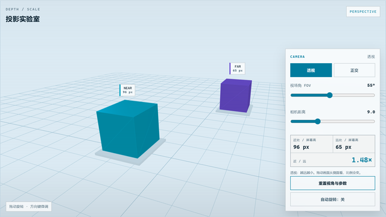
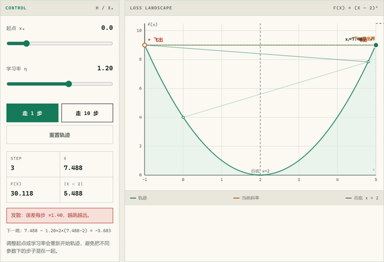
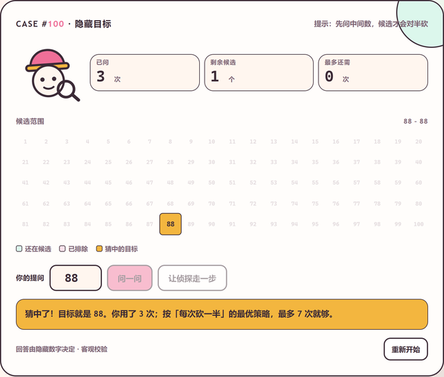
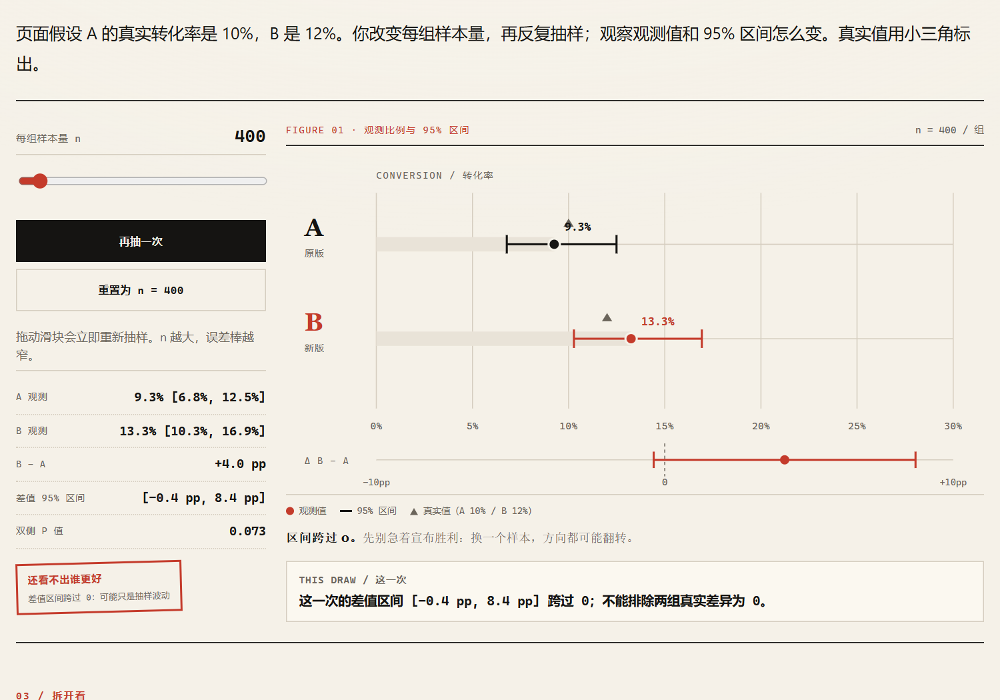
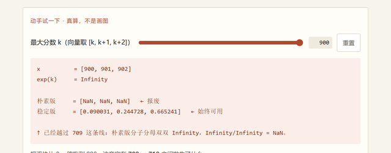
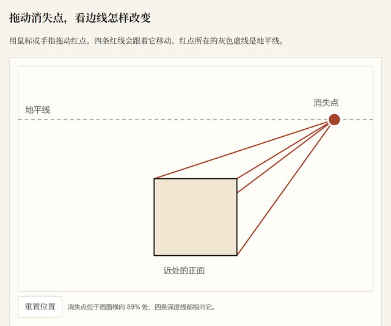
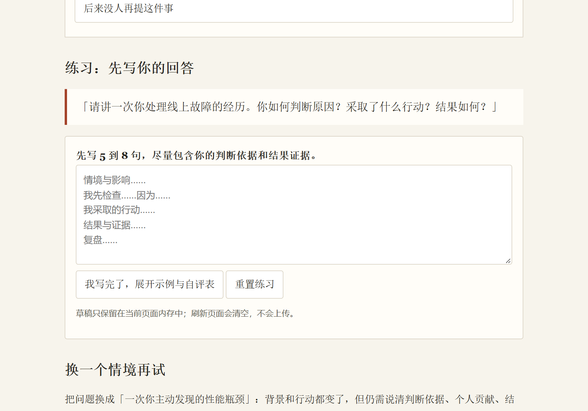

# knowvori · 交互式学习 Skill
</img>

> **说出你想学什么，拿到一节能动手探索、通过练习检查理解的交互课程。**

一节课不是一篇文章，也不是一张漂亮网页，而是一个**围绕具体学习目标设计的微型学习环境**：能操作、能预测、能看见自己算错在哪、能在一道没见过的新题上把学到的东西用出来。

## 30 秒开始

```bash
npx skills add yoruniubi/knowvori --skill knowvori
```

安装后，对 Agent 说：

> 「我想理解 Attention，会 Python，但矩阵基础一般。做一节中文交互课程，让我先通过操作理解，再做一道练习。」

Agent 会拆目标、找卡点、设计交互与练习，最后交付一个**单文件 HTML**。双击打开就能学，不需要服务器，也不需要联网。

> 本地安装：在仓库根目录执行 `npx skills add . --skill knowvori`。

## 样例课程

七份可直接打开的单文件示例，覆盖数值计算、空间关系、算法、统计和面试表达。它们共用教学标准，**但不共用模板**：工程纸、手绘、杂志数据页、3D 空间、示波器实验室、糖果色游戏、编辑排版，各说各的话。页面深浅色跟随系统。

> 新增的四份刻意换了视觉语言：一个实时 3D 相机实验、一个梯度下降控制台、一个二分查找小游戏、一张会重新抽样的数据报纸。3D 示例内联 Three.js（MIT），文件约 565KB；仍是单文件、零外部请求、断网可用。

> 图片统一为 10:7 预览，点击看大图；点击标题直接打开课程。

### 3D · 空间

[](docs/screenshots/three-camera-depth.png)

**[为什么近处的东西更大](skills/knowvori/examples/three-camera-depth.html)**<br><sub>Three.js · 透视 / 正交 · 拖拽旋转 + 视场角</sub>

### 动态实验室 · 数值

[](docs/screenshots/gradient-descent-lab.png)

**[学习率一大，为什么飞出去](skills/knowvori/examples/gradient-descent-lab.html)**<br><sub>Canvas · 梯度下降 · 轨迹、学习率与重置</sub>

### 游戏化 · 算法

[](docs/screenshots/binary-search-detective.png)

**[100 个数字，最多问几次](skills/knowvori/examples/binary-search-detective.html)**<br><sub>DOM / CSS · 二分查找 · 候选区间与次数上界</sub>

### 数据叙事 · 统计

[](docs/screenshots/ab-test-editorial.png)

**[12% 比 10%，真的更好吗](skills/knowvori/examples/ab-test-editorial.html)**<br><sub>SVG · 抽样 / 95% 区间 · 重新抽样看波动</sub>

### 工程笔记 · 数值

[](docs/screenshots/softmax.png)

**[softmax 为什么必须减最大值](skills/knowvori/examples/softmax-数值稳定.html)**<br><sub>滑块 · 溢出对照 · 从 NaN 到稳定计算</sub>

### 手绘 · 空间

[](docs/screenshots/one-point-perspective.png)

**[一点透视：边线为什么会汇聚](skills/knowvori/examples/one-point-perspective.html)**<br><sub>拖拽 · 消失点 · 键盘方向键 / Home / End</sub>

### 编辑 · 面试

[](docs/screenshots/interview-practice.png)

**[面试练习：讲清一次线上故障](skills/knowvori/examples/interview-practice.html)**<br><sub>开放题 · 自评 rubric · 不假装自动评分</sub>

### 示例验收

- 7 份示例都跑过 `validate-lesson.mjs` 的 18 项静态检查；6 份全通过，3D 示例因内联 Three.js 体积 565KB，保留 1 条「体量」warning，已在上面注明。
- 在 Chromium / Edge（Playwright，headless）里实测 320 / 390 / 768 / 1100px 视口、深色与浅色主题：无横向溢出，关键画布/图表可见。
- 16 道选择题逐题点过：答对显示确认与理由，答错展开解释并标出正确项。
- 7 份文件用 `file://` 打开时只产生本地 `file://` 请求，无网络请求；断网可打开。
- 未实测：Safari / Firefox、真机触控、屏幕阅读器的完整流程。3D 场景在 headless 环境使用软件 WebGL，未覆盖低端 GPU 表现。

### 示例自评记录

| 轮 | 类别 | 发现 | 修法 |
|---|---|---|---|
| 1 | 教学 | 新样例的练习只有对错，没有解释「为什么错」；推导链也不完整。 | 选择题补 `data-why`，并补答后解释和「现象 → 为什么 → 所以」段落。 |
| 2 | 交互 | A/B 窄屏重绘后仍用旧 viewBox；三份新样例的选择题按钮没有绑定。 | 加 resize 重绘、逐题绑定与答错标正确项，并用 Playwright 逐题点过。 |
| 3 | 体验 | 320px 下 3D / 图表 / 网格可能横向溢出；3D 自动旋转需要暂停入口。 | 加窄屏布局与 max-width；3D 补暂停 / 继续、重置和键盘视角。 |
| 4 | 事实性 | A/B 的区间与检验、梯度稳定区间、二分上界都容易写错。 | 用公式重算并做手算对照；页面统一标「客观校验」。 |

## 它和「让 AI 写一篇讲义」有什么不同

- **不是看，是操作**：拖滑块、转 3D 视角、移消失点、抽一次样、写回答，页面状态跟着你变。
- **不是先看答案**：练习默认藏起解析，先写下自己的判断，再对照。
- **不是只记结论**：关键结论要求走完「现象 → 为什么 → 所以 → 不这样会怎样」。
- **不是假演示**：数字由页面里的 JS 真算，投影矩阵、梯度轨迹、抽样区间都会随输入变化；极端输入会暴露 `NaN`、溢出或边界。
- **不是黑盒交付**：开放题明确不自动评分，检查了什么、没检查什么都会写清楚。

## 你会得到什么

| 能力 | 说明 |
|---|---|
| **一节课一个目标** | 不是知识点目录，而是能在一节课内验证的一个能力。 |
| **可操作的演示** | 参数、图形、代码或情境，至少有一个能亲手改。 |
| **先答后看的练习** | 选择题有干扰项解释；开放题给 rubric，不假装打分。 |
| **迁移题** | 换一个没见过的情境，检查是不是真的会用。 |
| **单文件交付** | 无 CDN、无在线字体、无外部请求；3D 示例内联 Three.js（MIT），仍是一个文件，离线、手机、深色模式都能用。 |
| **可恢复** | 演示能重置，练习能重来，不会把你锁死在一步。 |

## 怎么用

说清三件事，Agent 就能开始：

1. **主题**：你想理解什么？
2. **基础**：你会什么、卡在哪？
3. **目标**：上完这节课，你想能做什么？

可以直接复制这些说法：

- 「我想理解 Attention，会 Python，但矩阵基础一般。做一节中文交互课程，让我先通过操作理解，再做一道练习。」
- 「我想练一点透视，能拖动消失点看边线变化，最后做两道迁移题。」
- 「帮我准备面试：讲清一次线上故障，先让我写，再看示例和自评表。」

打开课程后，按页面上的路径走：**先预测 → 再操作 → 看反馈 → 读解释 → 做迁移**。演示可以重置，练习可以重来。

## 质量不是靠「看起来不错」

每节课交付前会过三层检查：

1. **结构自检**：18 项自动检查，覆盖离线可用、答后展开、迁移题、深色模式、可操作控件、反馈区，以及练习是否真的能作答。
2. **三类自评**：教学、交互、体验各找一轮问题，不机械凑轮次。
3. **真实交互走查**：按「预测 → 操作 → 反馈 → 解释 → 迁移」实际点一遍，并说明哪些验过、哪些没验。

手动验收：

```bash
node skills/knowvori/scripts/validate-lesson.mjs 你的课程.html
```

它不会把「选择题答对」说成「已经掌握」，也不会把静态检查说成教学有效。

## 适合谁

- 想快速建立直觉的自学者
- 要把复杂概念讲清楚的工程师、教师、内容创作者
- 面试、考试、分享前想练「讲明白」的人

**不适合**：需要完整课程体系、班级管理、自动批改开放题，或希望完全替代系统学习的人。

## 不做的事

- ❌ 知识点罗列式目录
- ❌ 只有结论没有推导
- ❌ 假动画 / 写死的假数字
- ❌ 自测题直接展示答案
- ❌ 引 CDN / 外部框架 / 在线字体（3D 示例内联 Three.js 且离线可用，是明确例外）
- ❌ 用分数 / 连击 / 排行榜做激励
- ❌ 把「页面上答对选择题」说成「已经掌握这门技能」

---

如果这个项目对你有帮助，欢迎 Star ⭐

*一节课最难写的不是解释，是「先不给答案」的那一段。*

## 友链
linux do社区：
https://linux.do